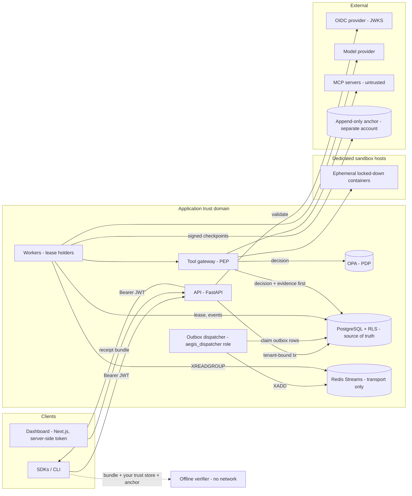

# Architecture

AegisTrace is a modular monolith (one Python distribution, `aegistrace`) deployed as three process roles from one container image:

- `api`
- `worker`
- `dispatcher`

The other pieces run outside it:

- PostgreSQL is the source of truth.
- Redis Streams carries dispatch messages only.
- OPA evaluates policy.
- An offline verifier needs none of the above.

## Components and code locations

| Component | Module | Notes |
|---|---|---|
| API and identity | `aegis_api`, `aegisguard.identity` | FastAPI and JWT validation (JWKS, asymmetric algorithms only) |
| Tenants, projects, agents | `aegisruntime.persistence.admin`, migrations | Composite foreign keys stop cross-tenant references |
| Workflow orchestrator | `aegisruntime.orchestration.service`, `.states` | The transition table is the single authority on legal state changes |
| Durable scheduling and leases | `aegisruntime.orchestration.leases` | Fencing tokens, recovery, retries, timeouts |
| Transactional outbox | `outbox` table, `aegisruntime.workers.dispatcher` | At-least-once delivery to Redis Streams |
| Tool gateway (enforcement point) | `aegisruntime.tools.gateway` | Validates, asks policy, records evidence, then executes |
| Policy decision point | OPA, `packages/aegisguard/policies/aegistrace/tools.rego`, `aegisguard.authorization.policy` | Fails closed |
| Evidence (hash chain, checkpoints, receipts) | `aegistrace.evidence` | No server dependencies |
| Offline verifier | `aegistrace.evidence.verifier`, `aegistrace-verify` CLI | INV-010 |
| Replay engine | `aegisruntime.replay` | Pure; its import boundary is enforced by a test |
| MCP bridge | `aegisruntime.mcpgw` | Stdio transport only; tools must be mapped by an admin |
| Sandbox | `aegisguard.sandbox.docker_runner` | Runs on dedicated sandbox hosts only |
| Approvals | `aegisruntime.approvals` | Bound to the action digest, consumed atomically |
| Model adapters | `aegisruntime.agents.model` | Deterministic mock and an OpenAI-compatible adapter |
| Observability | `aegistrace.observability`, `aegistrace.logging` | Prometheus metrics and redacting JSON logs |
| SDKs, CLI, dashboard | `packages/sdk-python`, `packages/sdk-typescript`, `aegis_cli`, `apps/studio` | |

## Component diagram



## A governed tool call

```mermaid
sequenceDiagram
  participant M as Model (untrusted)
  participant W as Worker (holds lease, token f)
  participant G as Gateway
  participant P as OPA
  participant DB as PostgreSQL
  participant T as Tool
  W->>M: messages (tool output labelled untrusted)
  M-->>W: proposal (tool, args)
  W->>DB: model.invoked event [fencing f]
  W->>G: invoke(tool, args)
  G->>G: registry lookup, schema validation (deny if unknown/invalid)
  G->>DB: read grants, approvals (server-side state)
  G->>P: evaluate(input built from server state)
  P-->>G: allow / deny / require_approval (errors become deny)
  G->>DB: COMMIT decision + tool.authorization [fencing f]
  alt allow
    G->>DB: COMMIT consume approval (if any) + tool.execution_started [fencing f]
    G->>T: execute(ctx with server-side tenant)
    T-->>G: output (validated, size-capped)
    G->>DB: COMMIT tool.execution_succeeded/failed [fencing f]
  else require_approval
    G->>DB: approval request; run to WAITING_FOR_APPROVAL
  end
```

If any commit fails, nothing after it happens. A worker that loses its lease fails its next fenced write with `StaleLease`.

## Process roles and database roles

| Process | DB role | Can do |
|---|---|---|
| api, worker | `aegis_app` | Read and write tenant-scoped tables **only for the tenant bound to the transaction** (forced RLS). No BYPASSRLS. Cannot update or delete events or checkpoints. |
| dispatcher | `aegis_dispatcher` | Read and update `outbox` only |
| migrations | `aegis_owner` | DDL. Never used by running services. |

The worker's recovery scans run through three `SECURITY DEFINER` functions (`scheduler_*`). They return only `(tenant_id, run_id)` pairs, and all processing then happens in a tenant-bound transaction.
