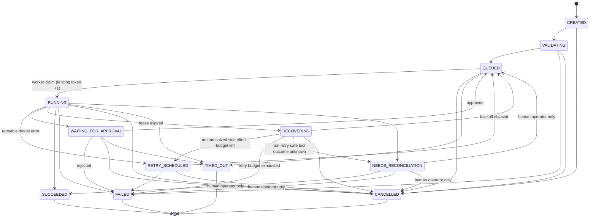

# Execution state machine

Source of truth: `TRANSITIONS` in `packages/aegisruntime/src/aegisruntime/orchestration/states.py`.

## Rules enforced on every transition (`service.transition`)

1. Lock the run row (`SELECT … FOR UPDATE`).
2. If the caller supplied a fencing token, it must equal the current one. Otherwise the result is `StaleLease` and nothing is written.
3. The target state must be in `TRANSITIONS[current]`. Otherwise the result is `IllegalTransition`.
4. Leaving `NEEDS_RECONCILIATION` requires an actor of kind `user` (`OperatorRequired`).
5. Append a `run.state_changed` event with the next sequence number. `UNIQUE(run_id, sequence_number)` is the backstop.
6. Update the projection (`runs.state`, head hash, last sequence), and clear the lease when the run comes to rest.
7. Write an outbox message when the target is `QUEUED`.
8. All of this commits in the caller's single transaction.

## Uncertain external effects (INV-008)

The gateway writes `tool.execution_started` with `retry_safe` before execution, and an outcome event after it. During recovery, if any non-retry-safe execution has a start event but no outcome, the run goes to `NEEDS_RECONCILIATION` and is **never** retried automatically. Exactly-once execution is not claimed. Retry-safe tools receive a stable idempotency key, derived from the action digest and step number.

Tests: `tests/integration/test_kernel.py`, `tests/e2e/test_flagship.py::test_uc05_*`.
